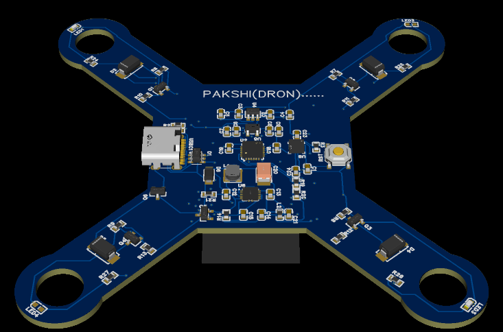
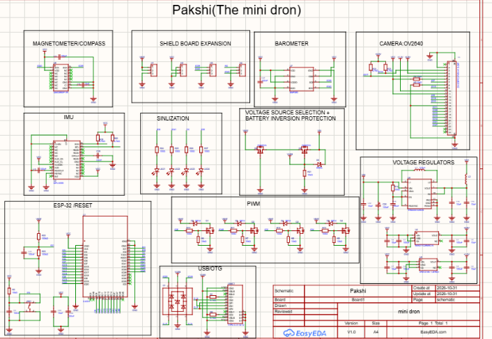

# Pakshi  — Mini Drone Flight Controller PCB

this is **Pakshi** ("bird" in Hindi), a tiny 4-layer flight
controller board for a mini quadcopter, built around an
**ESP32-S3**. it has its own sensors (IMU, compass, barometer), 
four motor drivers, LiPo power handling and USB-C, all on one board.

## Demo Video

▶️ [lapse link](https://youtu.be/jbQo66OVOyo)

## lapse link

▶️ [lapse link](https://lapse.hackclub.com/timelapse/XGq26Qyi9MZT)

## Project
### 3D PCB Representation

### PCB Layout

### Circuit Schematic



## What in this repo

```
dron/
├── BOM.csv                      # bill of materials
├── Gerber_PCB_2026-11-01/       # manufacturing file
├── DXF_mini dron_2026-11-1/     # schematic
└── OBJ file/                    # 3D models OBJ
    ├── OBJ FILE.obj             # main drone board
    └── OBJ_PCB_Arduino shield.obj   # Arduino shield board
```

## How to get the board made

1. Download `Gerber_PCB_2026-11-01/` (zip the folder if your fab asks for a single file)
2. Upload it to a PCB fab like [JLCPCB](https://jlcpcb.com/) or [PCBWay](https://www.pcbway.com/)
3. Select **4 layers**, and use the board size it detects
4. If you want it assembled, upload `BOM.csv` and the pick-and-place data (`FlyingProbeTesting.json` has the component coordinates in mil)
5. Official ordering steps from EasyEDA: <https://prodocs.easyeda.com/en/pcb/order-order-pcb/index.html>


## Status

- [x] Schematic
- [x] PCB layout + Gerbers
- [x] BOM
- [x] 3D model
- [ ] Firmware 
- [ ] Assembled + flight tested 

## AI disclosure

> be honest here i use AI for better component selecting"
