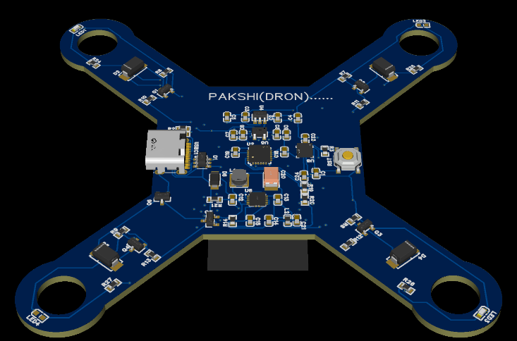
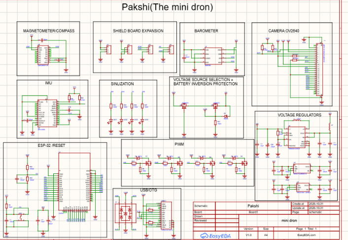

# Pakshi — Mini Drone

**Pakshi** (पक्षी, meaning "bird" in Hindi) is a compact, 4-layer flight controller PCB designed for a mini quadcopter. 
The board is built around the **ESP32-S3** and brings the main flight-control electronics together on a single PCB.

The design includes an IMU, compass, barometer, four motor-driving stages, LiPo power-handling circuitry, and a USB-C connection.

## Demo and Development

- **Demo Video:** [Demo video](https://youtu.be/jbQo66OVOyo)
- **lapse:** [lapse video](https://lapse.hackclub.com/timelapse/XGq26Qyi9MZT)

## PCB Design

### 3D


### PCB Layout


### Schematic


## Feature

- ESP32-S3-based flight controller.
- Four-layer PCB design.
- On-board IMU, compass, and barometer.
- Four motor-driving stages.

## Repository Structure

```text
Pakshi-Mini-Drone/
│
├── README.md
├── JOURNAL.md
├── BOM.csv
│
├── PCB/
│   └── EasyEDA_Project/
│       ├── project.epro
│       └── project.epro2
│
├── Gerber_PCB_2026-11-01/
│   ├── Gerber files
│   └── Drill files
│
├── Schematic/
│   └── schematic.dxf
│
├── OBJ file/
│   ├── OBJ FILE.obj
│   ├── OBJ FILE.mtl
│   ├── OBJ_PCB_Arduino shield.obj
│   └── OBJ_PCB_Arduino shield.mtl
│
└── image/
    ├── 3d.png
    ├── pcb.png
    └── schematic.png
```

## How to Use This Project

1. Download `Gerber_PCB_2026-11-01/` folder.
2. Upload the Gerber files in PCB manufacturer such as [JLCPCB](https://jlcpcb.com/) or [PCBWay](https://www.pcbway.com/).
3. Check the board dimensions and Gerber preview before ordering.
4. For PCB assembly, upload the BOM and order parts

## Development Journal

The development of Pakshi was completed through four major phases.

| Phase | Work Description | Time |
|---|---|---|
| Phase 1 | Component Selection and Modification | 1 Hour |
| Phase 2 | Schematic Wiring and Verification | 2 Hours |
| Phase 3 | PCB Layout and Component Placement | 2 Hours |
| Phase 4 | PCB Routing and Error Correction | 2 Hours |
| **Total** | **Development Time** | **7 Hours** |

For detailed development activities, see [JOURNAL.md](JOURNAL.md).

## Project Status

- [x] Component selection
- [x] Schematic design
- [x] PCB layout
- [x] PCB routing
- [x] Bill of Materials
- [x] 3D model export
- [x] Gerber generation
- [x] EasyEDA project files
- [ ] PCB fabrication
- [ ] PCB assembly
- [ ] Physical hardware build
- [ ] Flight testing

## AI Disclosure

I used AI as an assistance tool during parts of this project, particularly for component research, component selection, and resolving design-related questions.

